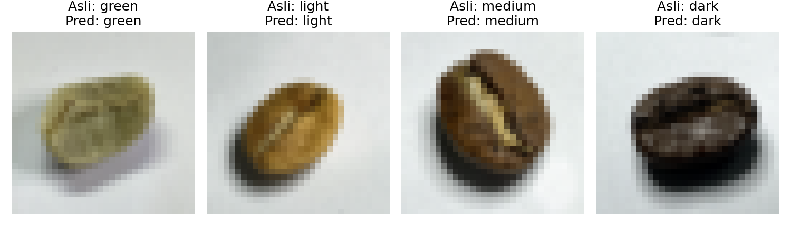
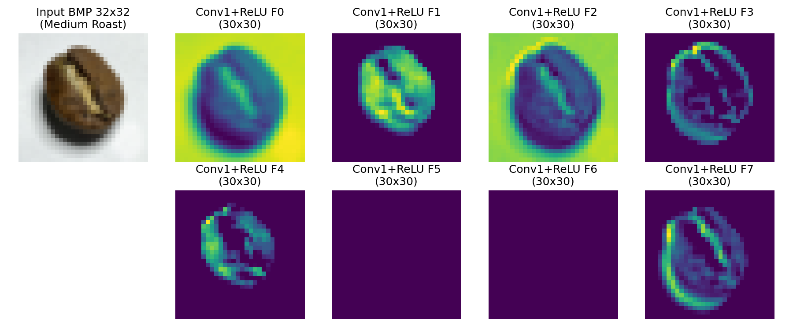
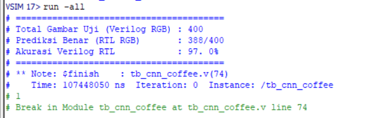
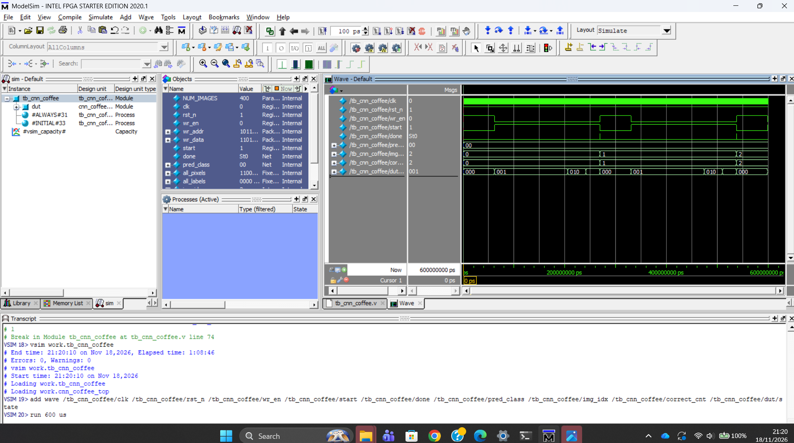

# Laporan Progres & Evaluasi Akurasi (Python vs Verilog RTL)

## 1. Perbandingan Eksperimen & Akurasi Uji (400 Citra `.bmp` 32×32)

| Tahap / Konfigurasi Model | Format Citra | Total Uji | Prediksi Benar | Akurasi |
| :--- | :---: | :---: | :---: | :---: |
| **Iterasi 1 — Baseline (1-Layer CNN Grayscale INT8)** | 32×32 Grayscale | 400 | 169 / 400 | 42.25% |
| **Iterasi 2 — Fitur Warna (1-Layer CNN RGB INT8)** | 32×32 RGB | 400 | 254 / 400 | 63.50% |
| **Iterasi 3 — Final Python Golden Model (2-Layer CNN RGB INT8)** | 32×32 RGB | 400 | 388 / 400 | **97.00%** |
| **Iterasi 4 — Final Verilog RTL (`cnn_coffee_top.v`)** | 32×32 RGB | 400 | 388 / 400 | **97.00%** |

> **Verifikasi Kesesuaian Bit-Exact (Python vs Verilog RTL):** Pengujian lintas 400 citra uji `.bmp` 32×32 piksel RGB menghasilkan **400/400 prediksi identik (100.00% Exact Match)** dengan akurasi **97.00% (388/400 benar)** pada perangkat lunak maupun perangkat keras. Log lengkap setiap sampel tersedia pada [`rtl_predictions.csv`](rtl_predictions.csv).

---

## 2. Alur Pengerjaan Step-by-Step

1. **Step 1A — Pembacaan Citra `.bmp` 32×32 & Validasi Model Python (`97.00%`):**
   Skrip Python membaca 400 citra uji `.bmp` beresolusi 32×32 piksel RGB, menjalankan inferensi aritmetika integer (`INT8`), dan memverifikasi prediksi kelas (*Green*, *Light*, *Medium*, *Dark*).
   

2. **Step 1B — Ekstraksi Fitur Konvolusi 1 & Aktivasi ReLU (`30×30×8`):**
   Visualisasi 8 kanal *feature map* berukuran 30×30 piksel setelah melewati operasi konvolusi 2D kernel 3×3 dan fungsi aktivasi `ReLU` pada citra biji kopi *Medium Roast*.
   

3. **Step 2A — Verifikasi Akurasi Verilog RTL pada ModelSim (`97.00%`):**
   Kompilasi dan simulasi seluruh 400 citra uji melalui `tb_cnn_coffee.v` menghasilkan 388 prediksi benar (**97.00%**) tanpa error kompilasi maupun *overflow* akumulator.
   

4. **Step 2B — Analisis Timing & Waveform FSM pada ModelSim:**
   Pengamatan gelombang sinyal per siklus clock (`clk`, `wr_en`, `start`, transisi `dut/state` dari `S_IDLE` hingga `S_DONE`, `done`, dan `pred_class`) memastikan setiap tahapan konvolusi, *max pooling*, dan *dense layer* berjalan deterministik.
   
